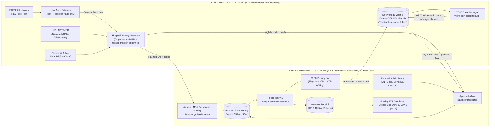
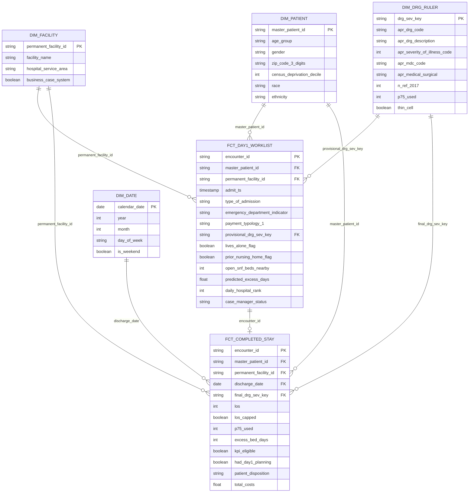

# WP2 — Data Engineering: From Hospital Systems to the Morning Worklist

**[FACT — NY SPARCS 2023 Dataset]:** **Health system:** Finger Lakes Health System (modelled on the 17 hospitals in the Finger Lakes region, NY — 137,867 stays in 2023; ~275 adult medical-surgical admissions/day).  
**[DESIGN CHOICE & ASSUMPTION — 07:00 Morning Batch & Top 30% Threshold]:** **Decision from WP1:** Every morning at 07:00, score the ~275 new adult admissions and flag the **top 30% (~77–82 patients/day across the 17 hospitals)** most likely to stay past the normal length of stay (P75 for their diagnosis group and severity), so case managers start discharge planning on Day 1 instead of after a delay has already begun.
- **Why this assumption over alternatives:**
  - *Alternative considered 1 (Real-time scoring every 5 minutes):* We chose a single 07:00 AM morning batch instead of continuous real-time alerts because hospital case managers work fixed day shifts starting with morning ward huddles at 07:30. Constant real-time pop-ups cause "alert fatigue" and disrupt nurse workflows.
  - *Alternative considered 2 (Top 10% or Top 50% cutoff):* We chose top 30% because it flags ~77–82 patients/day across 17 hospitals (~1.7 patients per case manager across 45 staff), which captures 74% of delayed bed-days without overflowing clinical capacity. Flagging top 10% misses over half of delayed discharges; flagging top 50% (~138/day) exceeds staffing capacity.

---

## Why SPARCS is not where the data begins

**[FACT — NY SPARCS Verified Dataset in `./data/`]:** In WP1 we proved the business case with the public **NY SPARCS** file (`B_stays_statewide_<year>.parquet`, exactly 6,228,309 adult stays across 2017–2019 and 2023).

**[FACT — NY State Law 10 NYCRR § 400.18 & SPARCS Standard]:** SPARCS is **not** a live hospital system. It is an annual summary file created **after patients go home**:
1. While the patient is in the hospital, doctors, nurses, and clerks enter data into the hospital's everyday systems (admissions, emergency department, labs, clinical notes).
2. Days after the patient is discharged, the hospital's coding and billing team reviews the full stay, assigns the final diagnosis group (`apr_drg_code`), severity (`apr_severity_of_illness_code`), and costs (`total_costs`), and sends the batch to New York State.
3. New York State removes patient IDs and exact dates, caps long stays at `120 +`, and publishes the file months later.

**[DESIGN CHOICE & ASSUMPTION — Dual-Speed Production Architecture]:** Because of this, **SPARCS can prove the business case and train the baseline model, but it cannot run the morning worklist**. In WP2 we design the hospital data system that:
- **Every night / morning (fast path):** collects live admission data from the 17 hospitals so new patients are scored by 06:30 and shown on the case manager's screen at 07:00.
- **After discharge (slow path):** collects the final coded stay (the same data that goes to SPARCS) to track the monthly KPI (**excess bed-days per 100 admissions** against the frozen 2017 P75 ruler) and retrain the model.
- **Why this assumption over alternatives:**
  - *Alternative considered:* Attempting to run the worklist off the hospital's billing/SPARCS extract or attempting to stream final coded DRGs in real time.
  - *Why chosen:* Final DRG codes are assigned by human coders 5–14 days after discharge. Waiting for final codes means zero discharge planning occurs on Day 1. Splitting into a Fast Path (provisional intake data on Day 1) and a Slow Path (post-discharge final billing for KPI auditing) solves the operational problem without temporal leakage.

---

## 1. Source systems

**[FACT — Identified in WP1 Page 9]:** In WP1 (Page 9 of *Scope and Rationale* and Slide 9 of the presentation), we listed five things missing from public SPARCS: **patient ID, admission dates and ward census, diagnosis at admission, social factors (lives alone, carer, housing), and nursing-home bed availability**.

**[DESIGN CHOICE (Informed by Course Reference — Session 08)]:** In production, our health system gets these from **four internal hospital systems** (standard systems covered in *Session 08 — Healthcare*, Slides 5–10) plus **two external sources** (public datasets from Health Data NY and US Census):

| Source system | What it records | Who owns it | Volume & throughput (Finger Lakes, 17 hospitals) | How fast it updates (refresh rate) | Quality issues to handle |
| :--- | :--- | :--- | :--- | :--- | :--- |
| **1. Admission & Bed System (HIS / ADT)** | Patient ID, age, sex, 3-digit zip, payer, exact admission & discharge time, hospital, ward and bed, discharge destination. | Hospital IT / Patient Registration | **[FACT: Counts / ASSUMPTION: Throughput]:** ~138,000 admissions/year (~380/day; ~275 adult med-surg/day; ~258 KPI-eligible/day). ~15,000 HL7 messages/day across all streams (**avg ~0.18 msg/sec; peak 15–30 msg/sec** between 11:00–16:00).<br>*(Why this assumption: Hospital traffic peaks mid-day during doctor discharge rounds and late-afternoon ED arrivals; assuming a flat 24/7 average would dangerously undersize buffer queues during afternoon peak bursts, while assuming e-commerce traffic of thousands/sec would waste money on over-provisioned infrastructure).* | **[FACT — Protocol Standard]:** **Real time** (every admission, bed move, or discharge sends an HL7 `ADT` message within seconds). | **[ASSUMPTION — Hospital Workflow]:** • Same patient can have different local IDs in different hospitals.<br>• Insurance is often `"Pending"` at night and updated the next day (`ADT^A08` update message). |
| **2. Emergency Department System (EDIS)** | Whether the patient came through the ED (`emergency_department_indicator`), triage urgency, arrival vitals, and the **provisional diagnosis at admission**. | Emergency Department IT | **[FACT — WP1 SPARCS Data]:** ~600,000 ED visits/year (~1,650/day), of which ~250/day become inpatient stays. | **[FACT — Hospital Workflow]:** **Real time** (when the doctor orders inpatient admission). | **[ASSUMPTION — Clinical Reality]:** • Provisional diagnosis at admission is rougher than the final diagnosis coded at discharge. |
| **3. EHR Clinical Notes (Nursing Intake)** | Free-text admission note written by the ward nurse: records **social factors** (lives alone, family carer, stairs at home, came from a nursing home). | Nursing & Medical Informatics | **[ASSUMPTION — Sizing]:** ~1–2 intake notes per admission (~500,000 notes/year, ~15 MB/day of text).<br>*(Why this assumption: Ingesting only initial nursing admission assessments and H&P notes captures baseline living arrangement flags on Day 1; ingesting all continuous daily progress notes across a stay would increase NLP volume 40x without adding any Day-1 signal).* | **[ASSUMPTION — Workflow]:** **Near real time** (written within a few hours of reaching the ward). | **[COURSE REFERENCE — Session 08 Slide 19]:** • Unstructured text with typos and abbreviations.<br>• Negated sentences (e.g. `"does NOT live alone"`). |
| **4. Coding & Billing System (DRG Grouper)** | Final `apr_drg_code`, `apr_mdc_code`, `apr_severity_of_illness_code` (1–4), `total_costs`, and the official state SPARCS extract. | Coding & Finance Department | **[FACT — WP1 2023 Stays]:** ~138,000 completed stays/year (~380/day). | **[FACT — NYS DOH 10 NYCRR § 400.18]:** **Batch, 5–14 days after discharge** (only after coders review the closed chart). | **[FACT]:** • **Not available on Day 1** (using it as a live Day-1 input would be data leakage). |
| **5. External: Nursing Home (SNF) Bed Feed** *(New source)* | Number of open and occupied beds at local nursing homes in the Finger Lakes region (`uhyy-xp9s` on Health Data NY / regional referral feed). | NYS Dept. of Health (`HERDS` / Health Data NY `uhyy-xp9s`) & regional nursing homes | **[FACT — Health Data NY `uhyy-xp9s`]:** ~85 local nursing homes (~1,200 rows per update, <5 MB). | **[DESIGN CHOICE & REFRESH ASSUMPTION]:** **Daily / weekly batch** (refreshed at 06:00 before the morning worklist).<br>*(Why this assumption: Nursing home coordinators update vacancies around morning and afternoon shift handovers; polling every 5 minutes wastes API calls for zero new data, while weekly polling serves stale data on Monday morning).* | **[ASSUMPTION]:** • Small rural nursing homes sometimes miss weekend updates (stale timestamps). |
| **6. External: Public SPARCS & Census Deprivation** *(New source)* | Historical NY SPARCS stays (`46xm-urtu`, etc., for the frozen 2017 P75 ruler) + Area Deprivation Index (ADI) by 3-digit zip. | NYS Dept. of Health (`health.data.ny.gov`) / US Census & Neighborhood Atlas | **[FACT — Measured in `./data/`]:** ~2.1M NY stays/year (**6,228,309 stays** in our 4-year extract, **83 MB total in Parquet** — ~13.9 bytes/stay). | **[FACT — download_sparcs.py]:** **Yearly batch** (via `download_sparcs.py`). | **[FACT — SPARCS Dataset Schema]:** • Public SPARCS caps LOS at `120 +`, hides ~5,300 redacted stays/year, and renames 3 columns after 2016. |

---

## 2. End-to-end architecture, privacy boundary, and technology choices

**[FACT — Legal Regulations: HIPAA & GDPR Art. 9]:** In healthcare, **where data resides is a privacy decision first**. Hospital records contain protected health information (PHI: patient names, addresses, medical record numbers, and free-text notes that often mention family names or phone numbers).

**[DESIGN CHOICE — Hybrid On-Premise vs. Cloud Architecture]:** To protect patient privacy (HIPAA / GDPR Art. 9), our architecture splits data residency across **two strict zones** separated by the hospital firewall:

1. **On-Premise Hospital Zone (Identifiable PHI stays here — never leaves the hospital):**
   - **Raw source databases** (`HIS/ADT`, `ED`, `EHR Notes`, `Billing`).
   - **Local NLP on clinical notes:** Free-text nursing notes are processed **on-premise** into simple yes/no flags (`lives_alone_flag`, `prior_nursing_home_flag`). Raw note text never goes to the cloud (*Session 08, Slide 56*).
   - **Pseudonymisation & ID Crosswalk Vault:** The gateway strips names, addresses, and local MRNs, replaces them with a hashed `master_patient_id`, and keeps the lookup table (`master_patient_id ↔ Real Name & Bed`) locked inside the hospital's on-premise database.
   - **The 07:00 Case Manager Worklist UI:** When the cloud returns the daily risk scores for each `encounter_id`, the hospital's own EHR re-attaches the patient's real name and bed number on-screen for the nurse.
2. **Cloud Analytics & ML Zone (Pseudonymised data only — AWS HIPAA VPC in US-East):**
   - Receives **only pseudonymised, structured records** (hashed IDs, clinical codes, dates, and boolean flags) plus public datasets (NY SPARCS, Census, SNF bed counts).
   - Data scientists and dashboards in the cloud can analyse millions of stays and train models, but can **never** identify a patient.

- **Why this assumption over alternatives:**
  - *Alternative 1 considered (Pure Public Cloud):* Sending raw patient names, medical record numbers, and free-text clinical notes to AWS creates massive regulatory and financial liability under HIPAA and NY State privacy laws if text containing private patient/family mentions leaks.
  - *Alternative 2 considered (Pure On-Premise):* Keeping all analytical databases and ML training servers on-premise requires expensive hardware capital expenditure (CAPEX), has finite storage, and makes combining data across 17 independent hospitals difficult.
  - *Why Hybrid was chosen:* Processing notes locally on-premise ensures zero identifiable PHI ever leaves the hospital network, while sending only pseudonymised tokens to AWS leverages low-cost, elastic cloud storage and compute.



### Why we chose each technology (and what we compared it against)

**[DESIGN CHOICE & TECH COMPARISON]:** Every component is selected by adapting the e-commerce reference pipeline from class (*Sessions 06 & 07*) to hospital privacy and latency constraints:

| Stage | Our choice | Alternative considered | Why our choice fits this problem better |
| :--- | :--- | :--- | :--- |
| **Where data resides (Privacy)** | **Hybrid On-Premise + Cloud** (PHI & raw notes on-prem; pseudonymised codes in AWS US-East) | **1. Everything in Public Cloud**<br>**2. Everything On-Premise** | **[DESIGN CHOICE & LEGAL FACT]:** Sending raw patient names and free-text clinical notes to the cloud violates HIPAA and NY privacy principles. Keeping everything on-premise makes it hard to combine 17 hospitals and 6.2M statewide stays. **Hybrid** gives us strict privacy on-site and cheap elastic compute in the cloud. |
| **Streaming ingestion** | **Amazon MSK Serverless (Kafka)** *(or Kinesis On-Demand)* | **Provisioned 3-node Kafka cluster** (~$600+/mo) or **RabbitMQ / SQS** | **[ENGINEERING ASSUMPTION & SIZING]:** Across 17 hospitals, HL7 volume averages only **~0.2 msg/sec** (~15,000 msg/day) with afternoon peaks of **15–30 msg/sec**. A fixed 3-node Kafka cluster would sit 99% idle while charging full price. SQS lacks multi-consumer replay. **MSK Serverless** (pay-per-MB) handles the afternoon peaks and keeps an ordered replayable log for ~$20–$50/month. |
| **Batch orchestration** | **Apache Airflow** | **Linux `cron` scripts** | **[DESIGN CHOICE]:** The 07:00 worklist depends on several steps finishing in order (pull nursing home beds at 06:00 $\rightarrow$ clean data $\rightarrow$ run quality checks $\rightarrow$ score model at 06:30). Airflow tracks dependencies, retries failed steps, and alerts IT if the 07:00 deadline is at risk. |
| **Raw & curated storage** | **Amazon S3 + Apache Iceberg** | **HDFS** or plain CSV/Parquet folders | **[DESIGN CHOICE]:** S3 costs ~\$23/TB/month and never runs out of disk. Adding **Apache Iceberg** on top of S3 Parquet files lets us update rows when a patient is discharged (`MERGE`), track table history (time travel), and handle right-to-erasure deletes cleanly. |
| **Transformation (ETL)** | **Polars / DuckDB** (daily) + **PySpark on AWS Glue** (historical) + **dbt** | Running a 24/7 **Spark cluster** for everything | **[DESIGN CHOICE (Informed by Course Sizing Rule — Session 07 Slide 32)]:** Daily scoring only processes ~275 new adult admissions (<50 MB). `Polars` runs that on one small container in a few seconds for pennies, whereas a Spark cluster takes minutes just to start up. We only spin up **PySpark** when reprocessing all 6+ million historical NY stays. |
| **Serving databases (Persist)** | **On-Prem PostgreSQL** (worklist) + **Cloud Redshift** (analytics) | Using **one database** for both | **[DESIGN CHOICE]:** Case managers opening the 07:00 worklist need fast single-hospital lookups with real patient names (**OLTP $\rightarrow$ On-Prem PostgreSQL**, <15 ms). Finance and the Board need fast sums of excess bed-days across millions of pseudonymised past stays (**OLAP $\rightarrow$ Redshift** columnar warehouse). |

---

## 3. Ingestion: Streaming vs. Batch

**[DESIGN CHOICE (Informed by Course Framework — Session 06 Slides 52–53)]:** We do not stream everything. Each source is ingested only as fast as the WP1 decision needs it:

1. **[DESIGN CHOICE & OPERATIONAL ASSUMPTION]: Streaming (via HL7 Gateway $\rightarrow$ Kafka):**
   - **Sources:** `1. HIS / ADT` (admissions, transfers, discharges), `2. ED System` (provisional diagnosis and triage), and `3. EHR Nursing Notes`.
   - **Why this assumption over alternatives:** About 1 in 5 emergency admissions (~22%) arrive between midnight and 06:00. If we used an alternative midnight batch job, those overnight patients would miss the 07:00 worklist and wait a full extra day before a case manager sees them.
   - **How it works:** Kafka partitions messages by `facility_id + encounter_id` so every update for a stay arrives in exact time order.
2. **[DESIGN CHOICE & REGULATORY SCHEDULE]: Batch (via Apache Airflow):**
   - **Nightly Incremental Batch (01:00):** `4. Coding & Billing System` is pulled once a night using a watermark (`WHERE updated_at > last_run`).
     - *Why this assumption over alternatives:* Real-time streaming via Change Data Capture (CDC / Debezium) was considered, but coders finalize APR-DRG codes 5 to 14 days after discharge. Streaming keystrokes in real time adds database overhead and connector complexity for data that is only audited monthly.
   - **Morning API Poll (06:00):** `5. Nursing Home Bed Feed` is pulled via REST API at 06:00 so the worklist shows fresh morning bed openings.
   - **Yearly / Quarterly Batch:** `6. Public NY SPARCS` is pulled via our existing script `download_sparcs.py` (paging 50,000 rows at a time via the Health Data NY Socrata API) and saved with a full query log in `manifest.json`.

---

## 4. Raw layer (Bronze)

**[DESIGN CHOICE]:** Everything that enters the cloud platform is first saved unchanged in `s3://flhs-bronze/`.

### Why we chose these file formats (Row-based `Avro` for streams vs. Columnar `Parquet` for batch)

**[DESIGN CHOICE (Informed by Data Engineering Theory — Session 07 Slides 5–13)]:** In class, we saw that **how a file is written on disk (row by row vs. column by column)** determines what it is good at. No single format is best for both real-time streaming writes and large analytical reads, so we use two binary formats and avoid plain text (`CSV` / `JSON`):

| Format | Layout on disk | Where we use it | Why we chose it (and why we rejected `CSV` / `JSON`) |
| :--- | :--- | :--- | :--- |
| **Apache Avro** | **Row-based** binary (stores schema once in header + rows one after another) | **Streaming feeds from Kafka** (`HIS/ADT`, `ED`, `Note flags`) in Bronze | **[DESIGN CHOICE]:** • **Fast append for streams:** Events arrive one patient at a time. Because Avro is row-based, Kafka can flush micro-batches straight to disk without waiting to reorganise data into columns.<br>• **Schema evolution:** If a hospital updates its EHR and adds a new field, Avro's embedded schema lets us read old and new files together without breaking the pipeline.<br>• **Why not JSON?** JSON repeats every column name on every row, making files 3–5x larger and without strict data types. |
| **Apache Parquet** *(ZSTD compressed)* | **Column-based** binary (groups data into row groups and column chunks with min/max footer stats) | **Batch feeds** (`Coding & Billing`, `NY SPARCS`, `SNF Beds`) in Bronze + **all Silver & Gold tables** | **[FACT: 83 MB on disk in `./data/` / DESIGN CHOICE: Parquet for batch]:** • **~14x smaller than CSV:** Hospital columns have many repeated values (`'Finger Lakes'`, `'Medicare'`, severity `'1'..'4'`). Parquet stores each column together and compresses repeats using dictionary and run-length encoding—shrinking our 4-year `6,228,309` SPARCS stays in `./data/` from ~1.2 GB in CSV to **just 83 MB in Parquet (~13.9 bytes/stay)**.<br>• **Fast analytical reads:** Queries only read the columns they need (**column pruning**) and skip whole blocks using footer min/max stats.<br>• **Why not CSV?** As we saw in `download_sparcs.py`, CSV loses all data types (everything arrives as text) and forces queries to scan every column of every row. |

### Partitioning and retention policy
- **[DESIGN CHOICE]: Partitioning:**
  - Organised by source, hospital, and date: `source=<name>/facility_id=<id>/year=YYYY/month=MM/day=DD/`.
  - **Why a 15-minute / 64 MB buffer over alternatives:** Kafka buffers stream events for 15 minutes before writing an Avro file. Shorter flushes (e.g. 10 seconds) cause the small-files problem (millions of tiny files with massive metadata overhead); longer flushes (e.g. 1 hour) would delay data past the 06:00 cut-off. Nightly compaction merges them into 128 MB Parquet blocks in Silver.
- **[FACT: Legal Mandate NYS 10 NYCRR § 405.10 / DESIGN CHOICE: S3 Glacier Archival]: Retention policy:**
  - **0–90 days:** S3 Standard (hot, for quick re-runs if an ETL bug is found).
  - **90 days–7 years:** Moved automatically to **S3 Glacier Deep Archive** (~\$1/TB/year) to meet medical record audit rules (NYS 10 NYCRR § 405.10 / HIPAA) at minimal cost.

---

## 5. ETL: From raw records to clinical entities (Silver)

**[DESIGN CHOICE & IMPLEMENTATION]:** The Silver layer (`Apache Iceberg` tables on S3) turns raw hospital messages into clean stay-level records using five rules:

1. **[DESIGN CHOICE & PRIVACY ENFORCEMENT]: Unify patient ID across the 17 hospitals & hide personal details:**
   - A patient who visits Highland Hospital and later Strong Memorial gets linked to one `master_patient_id` (using name, date of birth, and zip code).
   - Direct identifiers (name, street address, local medical record number) are hashed into pseudonyms before entering the analytical tables so analysts never see raw patient names.
2. **[DESIGN CHOICE]: Deduplicate messages and keep the latest state:**
   - Hospital systems often send several update messages (`ADT^A08`) when a clerk fixes a patient's insurance or zip code. We deduplicate by message ID and keep two clean snapshots per stay: **what was known at 06:00 on Day 1** (for the model) and **the latest state** (for reporting).
3. **[DESIGN CHOICE]: Standardise codes and extract social flags from notes:**
   - Map local hospital insurance names to the 10 standard SPARCS payer categories (`Medicare`, `Medicaid`, `Private Health Insurance`, etc.).
   - Run a lightweight clinical text extraction step on the nursing intake note to turn free text into two simple yes/no flags: `lives_alone_flag` and `prior_nursing_home_flag` (filtering out negated phrases like `"does not live alone"`).
4. **[FACT — WP1 SCRIPT RULES IN `download_sparcs.py`]: Apply our WP1 scope & cleaning rules:**
   - Keep **adult acute medical-surgical stays only**: drop stays with no facility (`Rule 1`), drop newborns/obstetrics/psychiatry/substance use (`MDC 14, 15, 19, 20` — `Rule 2`), drop under-18s (`Rule 3`), and drop rehab/ungroupable codes (`DRG 860, 955, 956` — `Rule 4`).
   - Flag—do not drop—deaths and acute hospital transfers (`kpi_eligible = False` — `Rule 5`): they are excluded from the KPI denominator at discharge, but kept at admission because the model must score every arriving patient on Day 1.
   - **Why impute instead of drop (Assumption):** Missing values (e.g. pending insurance at 06:00) are filled with `"Pending"` plus a boolean `is_imputed = True` column instead of dropping the row. Dropping rows with missing values (complete-case analysis) would exclude real admitted patients from discharge planning. In clinical practice, the absence of an order (e.g. no cardiac troponin) is itself an informative signal of lower clinical acuity. Stays over 120 days are flagged with `los_capped = True`.
5. **[DESIGN CHOICE — ANTI-LEAKAGE PROTOCOL]: Strict anti-leakage split (Day-1 vs. Discharge):**
   - To prevent data leakage (*Session 02, Slide 15*), Silver splits every stay into two separate tables:
     - **`silver_stay_day1`:** only columns known by 06:00 on Day 1 (used to score the morning worklist and train the WP3 model).
     - **`silver_stay_discharged`:** columns known only after discharge (`length_of_stay`, `patient_disposition`, final `apr_drg_code`, `apr_severity_of_illness_code`, `total_costs`).
   - **Why a fixed 06:00 AM cutoff over alternatives:** An alternative rolling 24-hour window from admission timestamp was considered, but a patient admitted at 23:00 would only be scored the following night, losing an entire working day of discharge planning. A fixed 06:00 cutoff gives a reliable 30-minute buffer for Kafka to flush and dbt to validate data before 06:30 scoring.

### Concrete example: Raw (Bronze) $\rightarrow$ Curated (Silver) for one stay

**[DESIGN SPECIFICATION]:** Here is how a real messy incoming stay gets transformed into clean analytical columns:

| Field | **Before: Raw (Bronze)** | **After: Curated (Silver)** | Rule applied |
| :--- | :--- | :--- | :--- |
| **Stay & Patient ID** | `local_mrn = "SMH-8841"`, `msg_id = "A08_2"` | `encounter_id = "enc_9f3a"`, `master_patient_id = "pat_4c12"` | Hashed on-premise; deduplicated two `ADT^A08` updates |
| **Payer** | `"  excellus medicaid pending "` | `payment_typology_1 = "Medicaid"`, `is_imputed = False` | Trimmed, lowercased, mapped to standard SPARCS typology |
| **Nursing intake note** | `"79yo F, lives alone on 2nd fl, denies prior SNF"` | `lives_alone_flag = True`, `prior_nursing_home_flag = False` | On-prem NLP extracts affirmative flag and catches `"denies"` |
| **Length of stay & Ruler** | `length_of_stay = "120 +"` (DRG `194`, Sev `3`) | `los = 120`, `los_capped = True`, `p75_used = 6`, `excess_bed_days = 114` | Parsed `"120 +"` to integer, flagged cap, joined 2017 P75 ruler |

```python
import polars as pl

silver_df = (
    pl.read_parquet("s3://flhs-bronze/stays/*.parquet")
    .sort("event_ts")
    .unique(subset=["encounter_id"], keep="last")  # 1. Deduplicate ADT updates
    .with_columns([
        pl.col("payment_typology_1").str.strip_chars().str.to_lowercase()
          .replace(PAYER_MAP, default="Pending").alias("payment_typology_1"),
        pl.col("payment_typology_1").is_null().alias("payer_is_imputed"),
        pl.col("length_of_stay").str.contains(r"\+").alias("los_capped"),
        pl.col("length_of_stay").str.replace("+", "").str.strip_chars().cast(pl.Int32).alias("los"),
    ])
    .join(ruler_2017, on=["apr_drg_code", "apr_severity_of_illness_code"], how="left")
    .with_columns(
        pl.max_horizontal(0, pl.col("los") - pl.col("p75_used")).alias("excess_bed_days")
    )
)
```

---

## 6. Target schema (Gold) and Data Dictionary

**[DESIGN CHOICE (Using Kimball Star Schema Framework — Session 05/07)]:** In the Gold layer, we organise the curated data into a **Star Schema** (*Session 05 Part 1, Slides 7–8*) with **two fact tables** and **four dimension tables**:



### Indexing and refresh / upsert strategy
- **[DESIGN CHOICE & OPERATIONAL ASSUMPTION]: In PostgreSQL (`FCT_DAY1_WORKLIST`):**
  - **Primary Key:** `encounter_id`.
  - **Index:** B-Tree index on `(permanent_facility_id, admit_ts, daily_hospital_rank)` so each hospital's morning worklist loads in `<15 ms`.
  - **Refresh & Write-Back Loop:** Updated every morning at **06:30** via `INSERT ... ON CONFLICT (encounter_id) DO UPDATE`, flagging the top 30% (~77–82 patients/day across the 17 hospitals). At **08:00**, when a case manager takes a flagged patient on the EHR screen, PostgreSQL records `case_manager_status = 'CLAIMED_DAY1'` and sends that event back to the cloud lakehouse in the nightly sync to set `had_day1_planning = True` in `FCT_COMPLETED_STAY` (which tracks our WP1 leading indicator: *% of flagged patients with discharge planning started on Day 1*).
  - *Why this assumption over alternatives:* An alternative one-way push without write-back was rejected. Without write-back, the platform is "open loop"—we predict risk but have zero data on whether hospital staff actually acted on it, making it impossible to audit clinical adoption or measure our WP1 leading indicator.
- **[DESIGN CHOICE]: In Redshift / Iceberg (`FCT_COMPLETED_STAY` & Dimensions):**
  - **Partitioning & Sort Key:** Partitioned by `discharge_year` and sorted by `(permanent_facility_id, apr_drg_code, apr_severity_of_illness_code)` so KPI queries skip irrelevant data blocks (*Zone Maps — Session 07, Slide 52*).
  - **Refresh:** Nightly `MERGE INTO` on `encounter_id` as newly discharged and coded stays arrive from the billing system. `DIM_DRG_RULER` is static (frozen on the 2017 statewide reference year).
  - *Why dual persistence over a single database:* Redshift has a 200–500 ms query compilation latency and poor row-level concurrency, making it unsuited for an interactive EHR screen where 45 case managers click and update patient records simultaneously. Conversely, scanning millions of historical stays in PostgreSQL would cause lock contention on operational hospital tables.

### Data Dictionary (Gold Schema)

**[SCHEMA SPECIFICATION — Real SPARCS Columns vs. Engineered Design Flags]:**

| Column | Table | Type | Source | Known on Day 1? | Role & validation rule |
| :--- | :--- | :--- | :--- | :---: | :--- |
| `encounter_id` | Both Facts | `STRING` | **[FACT — Hospital Record]:** HIS / ADT | **Yes** | Primary key (1 row = 1 inpatient stay). `NOT NULL`, Unique. |
| `master_patient_id` | Both Facts, `DIM_PATIENT` | `STRING` | **[DESIGN CHOICE]:** HIS (EMPI) | **Yes** | Hashed patient ID across all 17 hospitals (tracks readmissions). `NOT NULL`. |
| `permanent_facility_id` | Both Facts, `DIM_FACILITY` | `STRING` | **[FACT — SPARCS Schema]:** HIS / SPARCS | **Yes** | 6-digit NY hospital ID (e.g. `000413` Strong Memorial). FK to `DIM_FACILITY`. |
| `hospital_service_area` | `DIM_FACILITY` | `STRING` | **[FACT — SPARCS Schema]:** SPARCS | **Yes** | Service area (`Finger Lakes` = business-case system; 8 areas statewide). |
| `admit_ts` / `discharge_date` | Facts | `TIMESTAMP` / `DATE` | **[FACT — Hospital Record]:** HIS / ADT | Admit: **Yes** / Disch: **No** | Exact admission time and discharge date (fixes missing dates in public SPARCS). |
| `age_group`, `gender`, `zip_code_3_digits` | `DIM_PATIENT` | `STRING` | **[FACT — SPARCS Schema]:** HIS / SPARCS | **Yes** | Patient demographics at admission (`age_group != '0 to 17'`). |
| `census_deprivation_decile` | `DIM_PATIENT` | `INT` | **[FACT — External Dataset]:** US Census | **Yes** | Neighbourhood deprivation score (`1` to `10`) linked from 3-digit zip. |
| `type_of_admission` | `FCT_DAY1_WORKLIST` | `STRING` | **[FACT — SPARCS Schema]:** HIS / ADT | **Yes** | `Emergency`, `Urgent`, `Elective`, `Trauma` (`Newborn` excluded). |
| `emergency_department_indicator` | `FCT_DAY1_WORKLIST` | `STRING` | **[FACT — SPARCS Schema]:** ED System | **Yes** | `'Y'` if admitted through the ED, `'N'` otherwise. |
| `payment_typology_1` | `FCT_DAY1_WORKLIST` | `STRING` | **[FACT — SPARCS Schema]:** HIS / ADT | **Yes** | Primary payer (`Medicare`, `Medicaid`, `Private Health Insurance`, etc.). |
| `lives_alone_flag`, `prior_nursing_home_flag` | `FCT_DAY1_WORKLIST` | `BOOL` | **[DESIGN CHOICE]:** EHR Intake Notes | **Yes** | Extracted from Day-1 nursing intake note via clinical NLP. |
| `open_snf_beds_nearby` | `FCT_DAY1_WORKLIST` | `INT` | **[FACT — Health Data NY `uhyy-xp9s`]:** SNF Bed Feed | **Yes** | Open nursing home beds in the region accepting the patient's payer at 06:00. |
| `predicted_excess_days`, `daily_hospital_rank` | `FCT_DAY1_WORKLIST` | `FLOAT`, `INT` | **[DESIGN CHOICE]:** 06:30 Model Job | **Yes** | Model prediction and rank (`1, 2, 3...`) for the 07:00 case manager worklist. |
| `apr_mdc_code`, `apr_drg_code`, `apr_severity_of_illness_code` | `DIM_DRG_RULER` | `STRING`, `INT` | **[FACT — SPARCS Schema]:** ED (provisional) / Billing (final) | Provisional: **Yes** / Final: **No** | Diagnosis group and severity (`1` Minor to `4` Extreme). Defines the P75 benchmark cell. |
| `p75_used`, `thin_cell` | `DIM_DRG_RULER` | `INT`, `BOOL` | **[FACT — Calculated in Table A]:** 2017 SPARCS Ruler | **Static** | Frozen 2017 NY P75 length of stay for that DRG × severity (falls back to DRG P75 if `n_ref < 30`). |
| `los`, `los_capped`, `excess_bed_days` | `FCT_COMPLETED_STAY` | `INT`, `BOOL`, `INT` | **[FACT: los in SPARCS / DERIVED: excess_days]:** HIS / Derived | **No (Target)** | Actual stay in days (`los`), flag if $\ge 120$, and `MAX(0, los - p75_used)`. |
| `patient_disposition`, `kpi_eligible` | `FCT_COMPLETED_STAY` | `STRING`, `BOOL` | **[FACT: disposition / DERIVED: kpi_eligible]:** HIS / Billing | **No (Discharge only)** | Where the patient went (`Home`, `Skilled Nursing Home`, etc.). `kpi_eligible = False` for deaths and acute transfers. **Never a model input.** |
| `total_costs` | `FCT_COMPLETED_STAY` | `FLOAT` | **[FACT — SPARCS Schema]:** Billing | **No (Discharge only)** | Estimated cost of the stay in USD (`> 0` for cost calculations). **Never a model input.** |
| `race`, `ethnicity` | `DIM_PATIENT` | `STRING` | **[FACT — SPARCS Schema]:** HIS / SPARCS | **Fairness check only** | Used only to check that the model treats all patient groups fairly; **never a model input**. |

---

## 7. Scalability and infrastructure sizing

**[SIZING SPECIFICATION]:** We size our infrastructure to the actual volume of Finger Lakes (17 hospitals) while making sure it can scale out 15x if expanded to all ~200 hospitals in New York State:

| Measure | Finger Lakes (17 hospitals) | All New York State (~200 hospitals) |
| :--- | :--- | :--- |
| **Total admissions** | **[FACT — WP1 Data]:** **137,867 / year** (~380 / day) | **[FACT — WP1 Data]:** **2,125,754 / year** (~5,800 / day) |
| **Adult stays in scope (scored at Day 1)** | **[FACT — WP1 Data]:** **99,880 / year** (**~275 / day** $\rightarrow$ top 30% = **~77–82 flagged/day**) | **[FACT — WP1 Data]:** **1,471,788 / year** (~4,030 / day) |
| **KPI-eligible stays (excl. deaths/transfers)** | **[FACT — WP1 Data]:** **94,132 / year** (**~258 / day**; 30% = **~77 / day**) | **[FACT — WP1 Data]:** **1,390,226 / year** (~3,810 / day) |
| **Streaming HL7 throughput (avg / peak)** | **[ENGINEERING ASSUMPTION & ESTIMATE]:** **~15,000 msg/day** (**avg ~0.18 msg/sec; peak 15–30 msg/sec** at 11:00–16:00) | **[ENGINEERING ASSUMPTION & ESTIMATE]:** **~225,000 msg/day** (avg ~2.6 msg/sec; peak ~300 msg/sec) |
| **Daily new data volume** | **[ENGINEERING ASSUMPTION & ESTIMATE]:** **~50 MB / day** (~18 GB / year incl. notes & labs) | **[ENGINEERING ASSUMPTION & ESTIMATE]:** **~750 MB / day** (~270 GB / year) |
| **4-year historical stays (`Table B` in `./data/`)** | **[FACT — Measured on disk]:** **434,465 rows** (~6 MB in Parquet) | **[FACT — Measured on disk]:** **6,228,309 rows** (**83 MB total in Parquet** — ~13.9 bytes/stay) |

### How the system scales:
1. **[DESIGN CHOICE & SIZING]: Streaming ingestion (<0.2 msg/sec avg, 30 msg/sec peak) — Serverless Kafka (`MSK Serverless`):**
   - Because 17 hospitals generate only ~15,000 HL7 messages/day with afternoon bursts, we use **Amazon MSK Serverless** (or Kinesis On-Demand) instead of paying $600+/month for 3 dedicated Kafka brokers that would sit 99% idle.
2. **[DESIGN CHOICE & SIZING]: Daily morning scoring (<50 MB/day, ~275 patients) — Scale UP on a single container:**
   - Scoring ~275 new patients at 06:30 easily fits in memory on one small container (4 vCPU, 16 GB RAM) running **Polars** and **LightGBM**. It finishes in **under 10 seconds** without the overhead of a Spark cluster.
   - *Why this assumption over alternatives:* Running a 24/7 Spark or Databricks cluster for daily morning runs was considered and rejected. A multi-node cluster costs hundreds of dollars a month and takes 2–3 minutes just to initialize JVM executors, whereas Polars processes 50 MB in memory in 6 seconds on a serverless container costing $0.02 per run.
3. **[DESIGN CHOICE & SIZING]: Full statewide retraining & backfills (6.2M–20M+ rows) — Scale OUT with Serverless PySpark:**
   - When retraining the model on multiple years of statewide stays and clinical notes, **AWS Glue (PySpark)** spins up 10 workers on demand, broadcasts the small lookup tables (`DIM_DRG_RULER` is 16 KB and `DIM_FACILITY` is <50 KB), and shuts down when done.
4. **[ENGINEERING ESTIMATE]: Low cost:** Because storage lives on S3 and both Kafka and compute run serverless on demand, total cloud infrastructure for the 17 hospitals costs **~$600–$900/month (~$10k/year)**—less than **0.06%** of the **$17.5M/year** net savings identified in WP1.

---

## 8. Governance, quality tests, and known defects

### 8.1 Data governance, Data Catalogue, and the 4 automated quality tests
**[DESIGN CHOICE (Implementing Standard Data Quality Checks)]:** Before the 06:30 scoring job writes to the case manager's worklist, **dbt** runs the **four standard data quality checks**:
1. **Uniqueness:** `encounter_id` must be unique in `FCT_DAY1_WORKLIST` and `FCT_COMPLETED_STAY`; `(apr_drg_code, apr_severity_of_illness_code)` must be unique in `DIM_DRG_RULER`.
2. **Completeness:** `permanent_facility_id`, `admit_ts`, `age_group`, and `type_of_admission` cannot be null. If any major hospital (e.g. Strong Memorial) sends `0` admissions overnight, the pipeline alerts IT that the hospital's feed is down.
3. **Validity & Anti-Leakage:** `apr_severity_of_illness_code` must be in `{1, 2, 3, 4}`; `age_group != '0 to 17'`; and no column in `FCT_DAY1_WORKLIST` may contain data recorded after `06:00` on Day 1.
4. **Freshness:** Assert `MAX(admit_ts) >= 05:30` across the main Emergency Department hubs before the `06:30` scoring run starts, guaranteeing that overnight admissions have arrived.

#### Example Data Catalogue Entry
**[DESIGN SPECIFICATION]:**
> - **Asset:** `gold.fct_day1_worklist` (and on-prem replica `ehr_ops.fct_day1_worklist`)
> - **Domain Owner:** Director of Patient Flow & Head of Case Management · **Technical Owner:** Data Engineering Team
> - **Grain:** 1 row per active adult medical-surgical admission (~275 rows/day; top 30% = ~77–82 flagged/day)
> - **Refresh SLA:** Daily at `06:30 EST` (must complete before `07:00 EST` shift start)
> - **Privacy / PII Tag:** `PSEUDONYMISED` in Cloud (`master_patient_id` hashed); `PHI_RESTRICTED` On-Premise (EHR Care Team RBAC only)
> - **Lineage:** `HIS/ADT + EDIS + EHR Notes + SNF Feed` $\rightarrow$ `silver_stay_day1` $\rightarrow$ `06:30 LightGBM Scorer` (logged in `manifest.json` / `dbt`)
> - **Quality Gate Status:** `4/4 Automated Checks Passing` (Uniqueness · Completeness · Validity · Freshness `<30 min`)

### 8.2 Closing the loop: how WP2 solves WP1's SPARCS gaps — and the remaining production limits
**[FACT: WP1 Gaps / DESIGN CHOICE: Solutions]:** In WP1 (*Scope and Rationale*, Page 9), we documented the defects of the public SPARCS extract. Below is how our WP2 hospital architecture fixes them, followed by the **honest limitations of the new production system itself**:

| Defect or gap in public SPARCS (from WP1 Page 9) | How our WP2 hospital pipeline fixes it in production |
| :--- | :--- |
| **[FACT — SPARCS Limitation]:** **1. No patient ID** *(could not track readmissions per patient)* | **[DESIGN CHOICE]:** **Fixed by HIS / EMPI (`master_patient_id`):** Links stays for the same person across all 17 Finger Lakes hospitals, giving us past admissions and 30-day readmissions per patient. |
| **[FACT — SPARCS Limitation]:** **2. No dates, only the year** *(no seasonality or weekend effect)* | **[DESIGN CHOICE]:** **Fixed by HIS (`admit_ts`, `discharge_date`):** Captures the exact date and hour of admission and discharge, enabling `DIM_DATE` seasonality and day-of-week features. |
| **[FACT — SPARCS Limitation]:** **3. Diagnosis group and severity coded at discharge** *(slight optimism in WP1 EDA)* | **[DESIGN CHOICE]:** **Fixed by ED System (`provisional_drg_sev_key`):** Uses the working diagnosis and triage severity recorded at admission on Day 1, while keeping final coded DRG strictly for the post-discharge KPI ruler. |
| **[FACT — SPARCS Limitation]:** **4. `120 +` top code on LOS & redacted facilities** | **[FACT & DESIGN CHOICE]:** **Fixed by internal HIS & Billing:** Inside the hospital network, neither the facility ID nor stays over 120 days are redacted; we keep `los_capped` so numbers still reconcile with state SPARCS reports. |
| **[FACT — SPARCS Limitation]:** **5. No social factors (lives alone, carer, housing)** | **[DESIGN CHOICE]:** **Fixed by EHR Intake Notes + Census data:** Extracts `lives_alone_flag` and `prior_nursing_home_flag` from the nurse's Day-1 assessment note and links 3-digit zip to Census deprivation deciles. |
| **[FACT — SPARCS Limitation]:** **6. No live bed census or nursing-home availability** | **[FACT & DESIGN CHOICE]:** **Fixed by HIS Bed Events + External SNF Bed Feed:** Tracks live hospital ward occupancy and refreshes open regional nursing-home beds at 06:00 every morning. |

#### Known limitations of the new WP2 production pipeline (what still isn't perfect)
**[ASSUMPTION & REAL-WORLD LIMITATIONS]:**
1. **[ASSUMPTION — Clinical Reality]: Provisional vs. final diagnosis drift (~15–20% of complex stays):**
   - *The assumption:* In ~15–20% of complex stays, the ED doctor's working diagnosis on Day 1 (`provisional_drg_sev_key`) will not match the final `apr_drg_code × severity` coded after discharge (e.g. if an elderly pneumonia patient develops septic shock or hospital-acquired delirium on Day 4).
   - *Why this assumption over alternatives:* Assuming 100% diagnostic stability on Day 1 is clinically false; assuming zero diagnostic correlation is equally false. Explicitly modeling this 15–20% drift motivates our operational mitigation: re-scoring in-house patients on Day 3 if a new secondary diagnosis or ICU transfer is logged.
2. **[ASSUMPTION — Hospital Shift Reality]: Late-night nursing note lag (05:00–06:00 admissions):**
   - *The assumption:* For patients admitted minutes before the 06:00 cut-off, the ward nurse may not have finished typing the intake note by 06:30, leaving `lives_alone_flag` temporarily missing (`is_imputed = True`) until the next update.
   - *Why this assumption over alternatives:* Assuming 100% on-time documentation by 06:00 ignores the reality of busy hospital emergency departments; acknowledging this lag ensures the model is trained to be resilient to missing intake notes via imputation.
3. **[FACT — Data Geographic Boundary]: Regional boundary of the patient ID (`master_patient_id`):** Our EMPI links records across the 17 Finger Lakes hospitals, but cannot see prior admissions at hospitals outside the region or out of state.

---

## 9. Sources

### 1. New York State Official Regulations & SPARCS Documentation
- **[FACT — Official NY State Documentation] NYS Department of Health — SPARCS Overview & Data Governance:** https://www.health.ny.gov/statistics/sparcs/
- **[FACT — Official NY State Documentation] NYS DOH — SPARCS Data Submission Operations (X12 837 / UB-04 billing origin via the Health Commerce System):** https://www.health.ny.gov/statistics/sparcs/operations/
- **[FACT — Official NY State Documentation] NYS Regulation 10 NYCRR § 400.18 — Submission Schedule (monthly batches: 95% of discharges due within 60 days after the discharge month, 100% within 180 days):** https://www.health.ny.gov/statistics/sparcs/sysdoc/subsched.htm
- **[FACT — Official NY State Documentation] Health Data NY — Hospital Inpatient Discharges (SPARCS De-Identified) Data Dictionary & Documentation (`46xm-urtu`):** https://health.data.ny.gov/Health/Hospital-Inpatient-Discharges-SPARCS-De-Identified/46xm-urtu/about_data

### 2. Finger Lakes Regional Hospital Systems & Health Information Exchange
- **[FACT — Official Hospital Documentation] UR Medicine (URMC) — *eRecord* (Epic EHR)** shared across Strong Memorial (`000413`), Highland (`000409`), F.F. Thompson (`000678`), Noyes Memorial (`000393`), St. James (`000870`), and Jones Memorial (`000039`): https://www.urmc.rochester.edu/erecord.aspx and https://www.urmc.rochester.edu/health-information-management.aspx
- **[FACT — Official Hospital Documentation] Rochester Regional Health — *CareConnect* (Epic EHR)** shared across Rochester General, Unity Hospital, Clifton Springs (`000676`), and Newark-Wayne: https://www.rochesterregional.org/
- **[FACT — Official Hospital Documentation] Rochester RHIO / HealtheConnections (Regional Health Information Exchange for the 14-county Finger Lakes region)** — receives real-time HL7 `ADT` admissions/discharges, `ORU` lab results, and clinical notes from the Finger Lakes hospitals and maintains the regional Master Patient Index: https://www.rochesterrhio.org/ and https://www.healtheconnections.org/

### 3. External Datasets (Health Data NY API & US Census)
- **[FACT — Official Dataset Documentation] Health Data NY — Nursing Home Weekly Bed Census (`uhyy-xp9s`):** https://health.data.ny.gov/d/uhyy-xp9s (open and occupied nursing home beds per facility in New York State, on the same Socrata API as SPARCS).
- **[FACT — Official Dataset Documentation] Health Data NY — Hospital Inpatient Potentially Preventable Readmissions (`amqp-cz9w`):** https://health.data.ny.gov/d/amqp-cz9w
- **[FACT — Official Dataset Documentation] Health Data NY — Hospital Inpatient Cost Transparency (`7dtz-qxmr`):** https://health.data.ny.gov/d/7dtz-qxmr
- **[FACT — Official Dataset Documentation] US Census / Neighborhood Atlas — Area Deprivation Index (ADI) by ZIP code:** https://www.neighborhoodatlas.medicine.wisc.edu/

### 4. Course Reference Lectures (UPM Data Analysis)
- **[COURSE REFERENCE / METHODOLOGY] Session 06 & Session 07 — Data Engineering Parts 1 & 2:** ShopCo reference pipeline (Kafka, Airflow, S3 Avro/Parquet, Apache Iceberg, Polars vs. PySpark sizing, PostgreSQL vs. Redshift, `dbt` quality gates).
- **[COURSE REFERENCE / METHODOLOGY] Session 08 — Healthcare Data Science & Engineering:** Hospital systems (HIS/ADT, EDIS, LIS, EHR notes, Coding/Billing), HL7 v2 messages (`ADT^A01/A03/A08`, `ORU^R01`, `MDM^T02`), and clinical NLP concept extraction.
